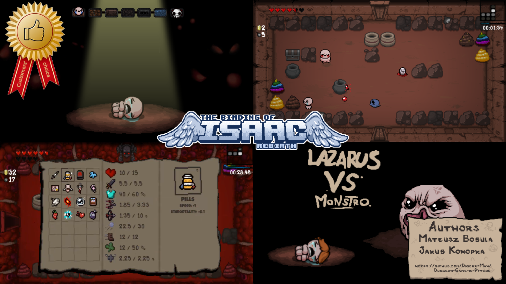
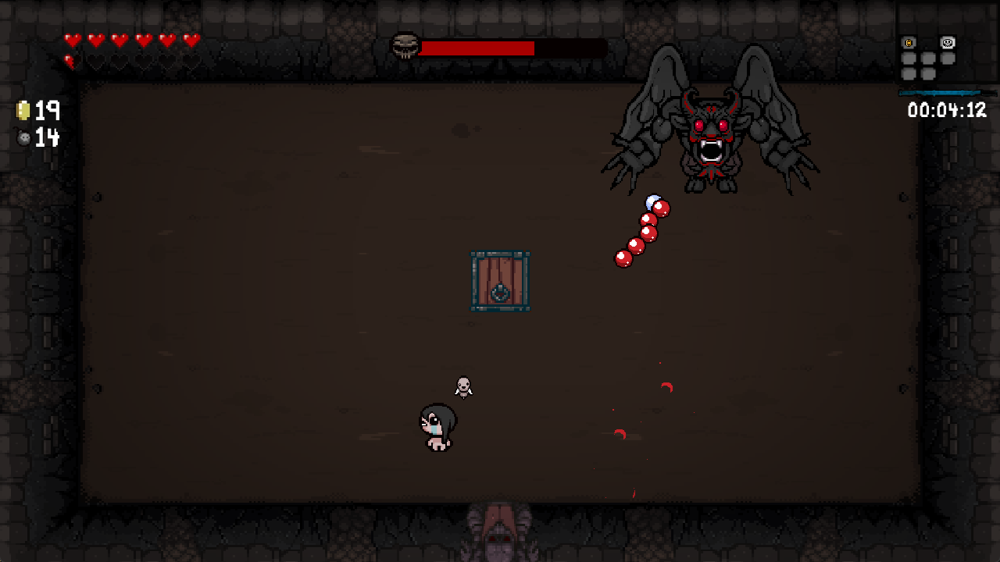
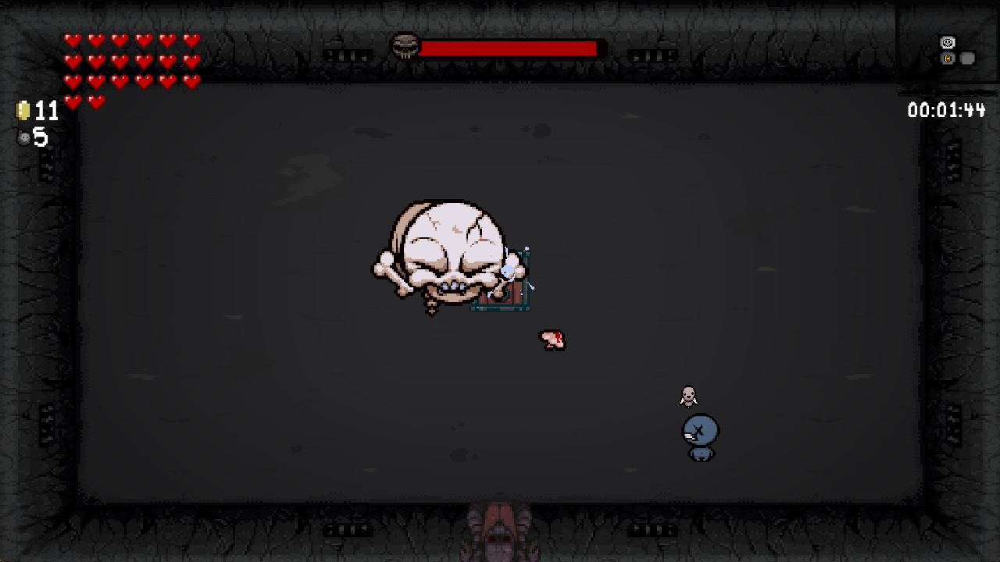
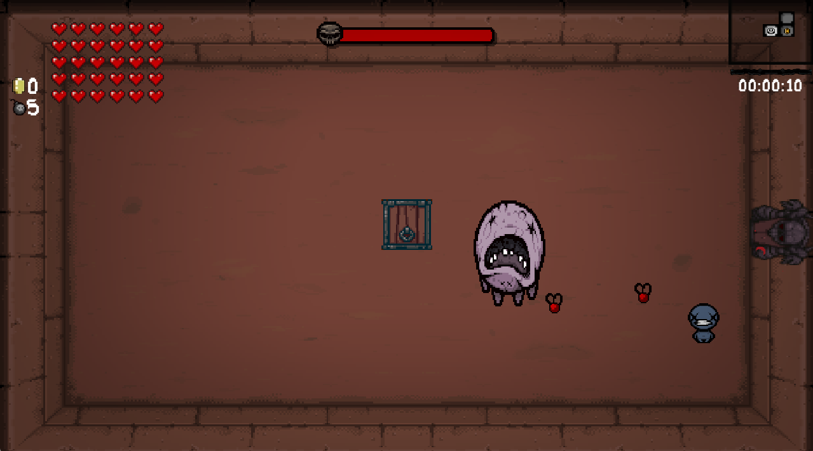
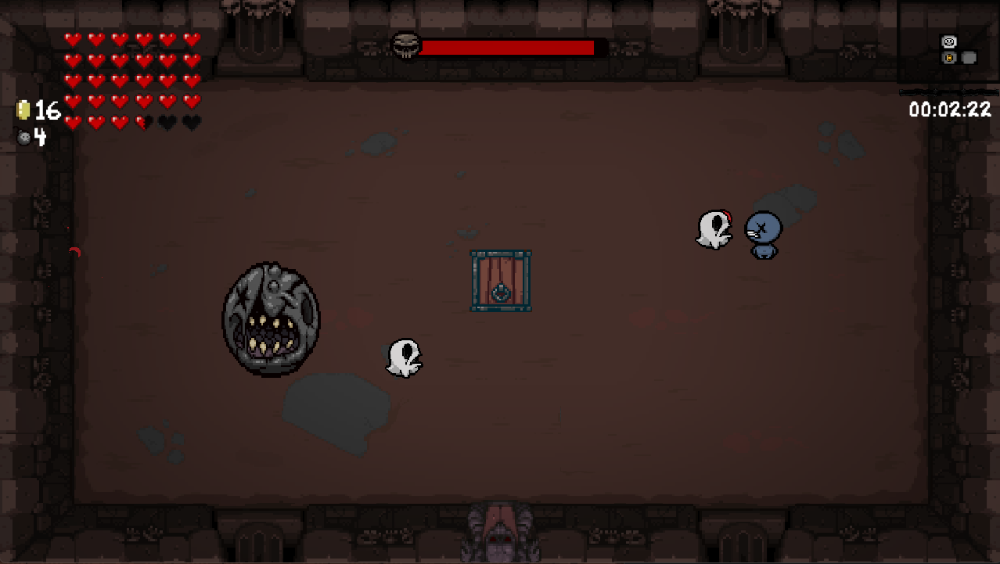

# 🕹️ Dungeon Game in Python  
## Roguelike Shooter Inspired by *The Binding of Isaac*

### Built with **Python** & **Pygame**  
- 🎓 AGH UST Project 2023/24 by Mateusz Bobula and Jakub Konopka 
- 🏆 **Winner** of the Customer's Choice Distinction
  


## 🎮 Gameplay features


- **Intense, roughly 30-minute** roguelike experience  
- Face **diverse enemies** and **challenging bosses**  
- Explore **ever-changing floors** with procedurally generated layouts  
- Encounter **progressively harder foes** as you descend deeper  
- Collect powerful items, manage resources, and adapt to survive and conquer

## 💀 Boss Fights

Face off against **5 unique bosses**, including **Alpha versions** of some:

| Satan | Forsaken |
|-------|----------|
|  |  |

| Duke | Husk |
|------|------|
|  |  |

---

## 👾 Enemies & Items

- 🧟‍♂️ **13 unique enemy types** — from crawling creeps to floor guardians  
- 🎁 **31 lootable items** — passives, actives, and consumables to power up your run  
- 🧙 **4 playable characters** — choose from Isaac, Lazarus, Eve or ???  
- 📊 **9 player statistics** — including health, damage, speed, luck, fire rate, range, and more 
- 💣 **Place bombs** to uncover hidden rooms or eliminate hordes  
- 🪙 **Collect coins** and spend them in mysterious in-game shops

# Controls
<kbd>&uarr;</kbd>
<kbd>&darr;</kbd>
<kbd>&larr;</kbd>
<kbd>&rarr;</kbd> - movement <br/>

<kbd>W</kbd>
<kbd>S</kbd>
<kbd>A</kbd>
<kbd>D</kbd> - shooting <br/>

<kbd>E</kbd> - place bomb <br/>

<kbd>Space</kbd> - pick up item / enter new floor <br/>

<kbd>Enter</kbd> - select menu element <br/>

<kbd>Esc</kbd> - go back in menu <br/>

# Usage
### Windows
```sh
python -m venv venv
```

```sh
.\venv\Scripts\activate
```

```sh
pip install -r requirements.txt
```

### Linux/MacOS
```sh
python -m venv venv
```

```sh
source venv/bin/activate
```

```sh
pip install -r requirements.txt
```

# Running the game

```sh
cd ./src
```

```sh
python ./main.py
```

# Credits
- Sprites resources: https://www.spriters-resource.com/pc_computer/bindingofisaacrebirth/
- Sounds: https://www.sounds-resource.com/pc_computer/bindingofisaac/sound/4368/
